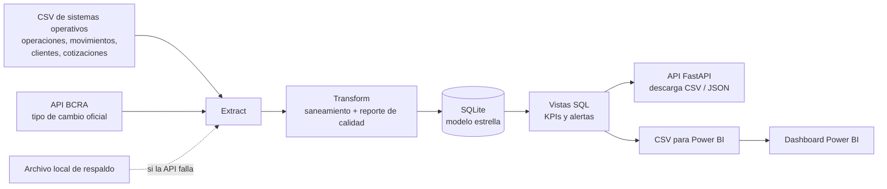
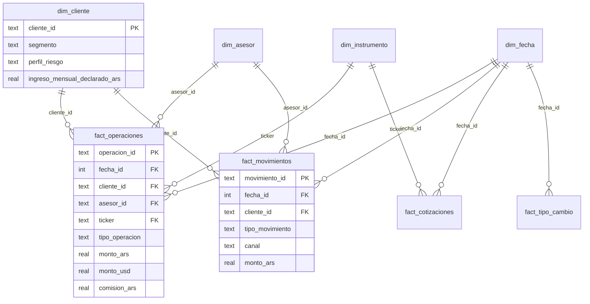

# Pipeline de datos de inversiones


Proyecto de punta a punta que cubre el ciclo completo del dato en una casa de
inversión: extracción desde archivos operativos y la API del BCRA, saneamiento,
modelado en esquema estrella, KPIs comerciales con SQL, una API para descargar
datos y alertas de operaciones inusuales para el área de cumplimiento.

> Todos los datos de clientes, operaciones y movimientos son **simulados**. No
> corresponden a personas ni a empresas reales.

## Qué resuelve

| Necesidad del negocio | Solución en el proyecto |
|---|---|
| Integrar datos de distintas fuentes | ETL en Python que une operaciones, movimientos de fondos, clientes, cotizaciones y tipo de cambio |
| Datos con errores de origen | Reglas de saneamiento con reporte de calidad (`reports/calidad_datos.json`) |
| Seguimiento comercial | KPIs mensuales: volumen operado, comisiones, captación neta, clientes activos, ranking de asesores |
| Que otras áreas descarguen datos sin pedir reportes | API REST con filtros y descarga en CSV o JSON |
| Control de cumplimiento (PLA/FT) | Alertas de fraccionamiento, depósitos fuera de perfil e "ida y vuelta" de fondos |
| Tableros para la dirección | Modelo listo para Power BI con medidas DAX y RLS ([guía](docs/powerbi.md)) |

## Arquitectura



## Stack

- **Python** (pandas, requests) para extracción y transformación
- **SQL** (SQLite) con CTEs, funciones de ventana y upsert idempotente
- **FastAPI** para la API de descarga
- **Power BI** para el tablero (esquema estrella, DAX, RLS)
- **pytest** y **GitHub Actions** para tests automáticos

## Estructura

```
├── scripts/generate_data.py   # genera los datos simulados (con errores a propósito)
├── etl/
│   ├── config.py              # rutas y parámetros de alertas
│   ├── extract.py             # lectura de CSV y API del BCRA con respaldo
│   ├── transform.py           # limpieza, conversión de moneda y modelo estrella
│   ├── load.py                # carga en SQLite (upsert) y exportación para Power BI
│   └── pipeline.py            # orquestador
├── sql/
│   ├── schema.sql             # tablas de hechos y dimensiones
│   └── views.sql              # KPIs y alertas
├── api/
│   ├── repository.py          # consultas parametrizadas
│   └── main.py                # endpoints
├── tests/                     # tests de transformación, SQL y API
├── docs/powerbi.md            # guía del dashboard y medidas DAX
└── reports/                   # reporte de calidad de cada ejecución
```

## Cómo correrlo

```bash
# 1. Entorno
python -m venv .venv
source .venv/bin/activate          # Windows: .venv\Scripts\activate
pip install -r requirements.txt

# 2. Datos simulados
python scripts/generate_data.py

# 3. Pipeline ETL (intenta la API del BCRA; si no responde, usa el archivo local)
python -m etl.pipeline

# 4. API
uvicorn api.main:app --reload
# Documentación interactiva: http://127.0.0.1:8000/docs

# 5. Tests
pytest -v
```

## Modelo de datos



## Calidad de datos

Los datos simulados traen los problemas típicos de los sistemas de origen. El
pipeline los corrige o los descarta y deja constancia en
`reports/calidad_datos.json`. Resultado de una ejecución:

| Problema | Tratamiento | Filas |
|---|---|---:|
| Operaciones duplicadas (reenvío de archivos) | Eliminadas | 540 |
| Fechas en formato DD/MM/AAAA | Convertidas a ISO | 600 |
| Tickers en minúscula o con espacios | Normalizados | 396 |
| Operaciones de clientes inexistentes | Descartadas | 59 |
| Cantidad igual a cero | Descartadas | 40 |
| Monto faltante | Recalculado como cantidad × precio | 150 |
| Movimientos duplicados | Eliminados | 91 |
| Tipos de movimiento en mayúsculas | Normalizados | 79 |

La carga es **idempotente**: usa `INSERT ... ON CONFLICT DO UPDATE` (el
equivalente a `MERGE` en SQLite), así que correr el pipeline dos veces no duplica
filas y las correcciones de origen actualizan los registros existentes.

## KPIs con SQL

Las vistas de `sql/views.sql` usan CTEs y funciones de ventana:

- `vw_kpis_mensuales`: volumen, comisiones, clientes activos, captación neta,
  captación acumulada (`SUM() OVER`) y variación mensual (`LAG()`).
- `vw_ranking_asesores`: ranking por comisiones (`RANK() OVER PARTITION BY`) y
  participación de cada asesor en el mes.
- `vw_volumen_instrumentos`: volumen y flujo neto por instrumento.

## API

| Método | Endpoint | Descripción |
|---|---|---|
| GET | `/health` | Estado y última carga |
| GET | `/operaciones` | Operaciones con filtros por cliente, ticker, tipo y fechas |
| GET | `/movimientos` | Depósitos y retiros con filtros |
| GET | `/kpis/mensuales` | KPIs comerciales por mes |
| GET | `/kpis/asesores` | Ranking de asesores de un mes |
| GET | `/alertas` | Alertas de cumplimiento |

Todos aceptan `formato=csv` para descargar el archivo. Ejemplos:

```bash
curl "http://127.0.0.1:8000/operaciones?ticker=AAPL&desde=2026-01-01&hasta=2026-03-31&limit=100"
curl -o alertas.csv "http://127.0.0.1:8000/alertas?formato=csv"
```

Las consultas son parametrizadas (sin riesgo de inyección SQL), la base se abre
en modo solo lectura y la paginación tiene un límite máximo.

## Alertas de cumplimiento

| Alerta | Regla |
|---|---|
| Fraccionamiento de depósitos en efectivo | 3 o más depósitos en efectivo entre el 80% y el 100% del umbral dentro de 7 días |
| Depósitos fuera de perfil | Depósitos del mes mayores a 5 veces el ingreso mensual declarado |
| Ida y vuelta de fondos | Depósito de más de $5 M retirado entre un 90% y un 110% dentro de 3 días |

Los umbrales están en `etl/config.py` y se cargan en la tabla `parametros`, así
que se ajustan sin tocar el SQL. Son **valores de ejemplo**, no umbrales
normativos. Las alertas no implican una operación sospechosa: son casos para que
un analista los revise.

## Dashboard

<!-- Agregar capturas en docs/img/ -->


La guía para armarlo (relaciones, medidas DAX y RLS) está en [docs/powerbi.md](docs/powerbi.md).

## Decisiones de diseño

- **SQLite** para que el proyecto corra sin instalar un servidor. El esquema es
  SQL estándar y se puede migrar a PostgreSQL.
- **Respaldo local del tipo de cambio**: si la API del BCRA no responde, el
  pipeline sigue con el archivo local y registra qué fuente usó en `log_ejecuciones`.
- **Descartar vs. corregir**: se corrige lo que se puede reconstruir sin inventar
  datos (formatos, monto = cantidad × precio) y se descarta lo que no (clientes
  inexistentes, cantidades inválidas). Todo queda en el reporte de calidad.
- **Transacción única por carga**: si algo falla, no queda una carga a medias.

## Próximos pasos

- Migrar a PostgreSQL y correr todo con Docker Compose.
- Programar el pipeline con cron o Airflow y cargar solo los datos nuevos.
- Agregar posiciones y valuación diaria de carteras para calcular AUM.

## Autor

**Valentino Daniel Lanatta** · [LinkedIn](https://linkedin.com/in/valentino-daniel-lanatta-2b986a25a)
